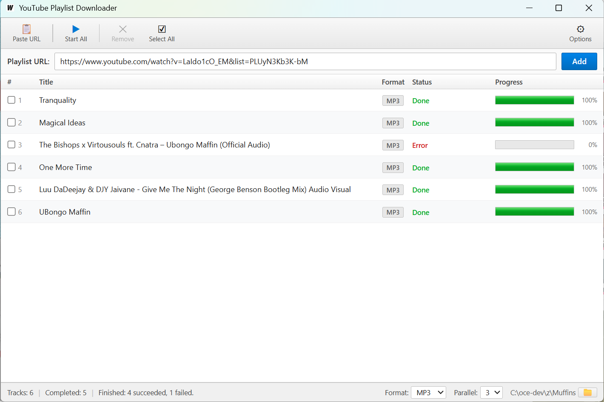

# ripper


Rip audio from YouTube playlists as a CLI or a desktop app.

`ffmpeg` and `yt-dlp` are fetched automatically on first run.



---

## Desktop app

A desktop GUI built with [Wails](https://wails.io) (Go + Svelte). Grab the latest build from [releases](https://github.com/Chitova263/YoutubePlaylistToAudioDownloaderCLI/releases):

| Platform | File |
|---|---|
| Windows | `YoutubePlaylistDownloader.exe` |
| macOS (Intel + Apple Silicon) | `YoutubePlaylistDownloader-macos.zip` — unzip and drag to `/Applications` |

> **macOS note:** the app is unsigned. On first launch right-click → Open to bypass Gatekeeper.

### Run from source

Requires [Go](https://go.dev), [Node.js](https://nodejs.org), and the [Wails CLI](https://wails.io/docs/gettingstarted/installation):

```bash
go install github.com/wailsapp/wails/v2/cmd/wails@latest
```

```bash
cd desktop-wails
wails dev        # development — hot reload on file changes
wails build      # production build → build/bin/YoutubePlaylistDownloader.exe
```

---

## CLI

### Install

Grab a binary from [releases](https://github.com/Chitova263/YoutubePlaylistToAudioDownloaderCLI/releases) or build from source:

```bash
go build -o ripper .
```

### Usage

```bash
# single playlist as mp3
ripper rip --playlists "https://youtube.com/playlist?list=PLxxxxxxx" --audio-format mp3 --output ~/Music

# multiple playlists from a file, 4 in parallel, wav format
ripper rip --input playlists.txt --audio-format wav --output ~/Music --parallel 4
```

### Flags

```
--audio-format string   output audio format: mp3, m4a, flac, opus, wav (required)
-o, --output string     output directory (required)
-i, --input string      text file with playlist URLs (one per line)
    --playlists string  comma-separated playlist URLs
    --parallel uint     max simultaneous playlist downloads (default 2)
    --concurrency uint  fragment threads per video (default 3)
    --config string     path to config yaml (default $HOME/.ripper.yaml)
-v, --verbosity int     log verbosity: 0=quiet 1=warn 2=info 3=debug (default 2)
```

`--input` and `--playlists` are mutually exclusive; one is required.

### Config file

Pass `--config ./config.yml` or let it default to `$HOME/.ripper.yaml`.

```yaml
audio-format: mp3
output: ./downloads
parallel: 4
input: playlists.txt
```

CLI flags override config values.

### Concurrency advice

`--parallel` controls how many videos download simultaneously. `--concurrency` controls fragment threads per video. Pushing these too high causes HTTP 429s and failed downloads.

Sweet spot: `--parallel 3 --concurrency 4`.

### Output structure

```
<output>/
└── <Playlist Title>/
    ├── Track One.mp3
    └── Track Two.mp3
```

---

## License

© 2026 Nigel Mukandi
